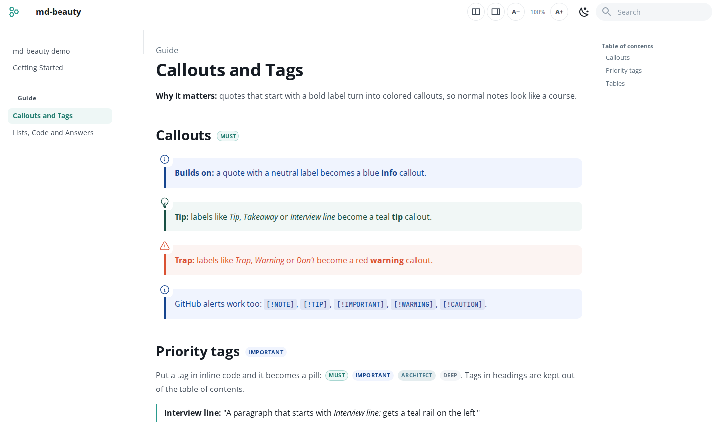
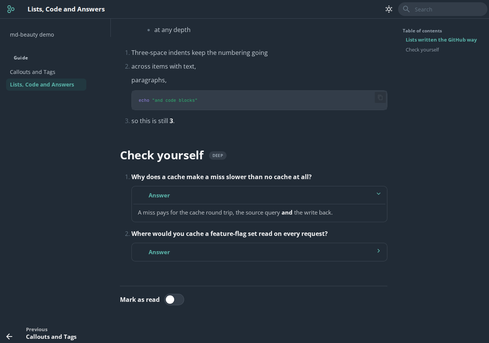

# md-beauty

**Turn your markdown notes into a clean, readable website with one command.**

Point it at one `.md` file, a few files, or a whole folder. You get a site with a sidebar, search, dark mode, colored callouts and a "mark as read" toggle. Your files stay plain GitHub markdown: no front matter and no special syntax.

**[See the live demo →](https://engmhmoud.github.io/md-beauty/)**



## Quick start

**With Docker (nothing to install):**

```bash
docker build -t md-beauty https://github.com/engmhmoud/md-beauty.git
docker run --rm --user "$(id -u):$(id -g)" -p 127.0.0.1:8000:8000 -v "$PWD":/docs md-beauty serve .
```

`--user` makes pages you add from the browser belong to you, not root.

**With Python 3.10+:**

```bash
pipx install git+https://github.com/engmhmoud/md-beauty.git
md-beauty serve notes/
```

Open http://127.0.0.1:8000. Saving a file reloads the page. If port 8000 is busy, md-beauty uses the next free port and prints it.

## Commands

| Command | What it does |
|---|---|
| `md-beauty serve` | Empty workspace (`./md-beauty-notes`): add or paste your first pages in the browser |
| `md-beauty serve notes/` | Live preview of a folder (all `.md` files inside it); you can add pages too |
| **Folder button** or `o` (while serving) | Switch to another folder without restarting by hand |
| `md-beauty serve intro.md setup.md` | Only these files (and related ones you list) |
| `md-beauty build notes/ -o site` | Static HTML in `site/`, ready for GitHub Pages, Netlify or any web server |
| `--title "My Notes"` | Site name (default: the H1 of `README.md`/`index.md`, or the folder name) |
| `--port 8080` | Use another port (or set `MD_BEAUTY_PORT=8080`) |
| `--host 0.0.0.0` | Open it from other devices on your network |

## Choosing the port

| How | Example | If the port is busy |
|---|---|---|
| Nothing | `md-beauty serve .` | Uses 8000, or the next free port (8001, 8002, …) and prints it |
| `--port` | `md-beauty serve . --port 8080` | Stops and tells you, so you never land on a port you didn't pick |
| Environment variable | `export MD_BEAUTY_PORT=8080` | Same as `--port`; handy as a personal default |
| Docker | `docker run --rm -p 127.0.0.1:8080:8000 -v "$PWD":/docs md-beauty serve .` | Pick the port on the **left** of `-p`; the right side stays 8000 |

With Docker, put the command after the image name: `docker run --rm --user "$(id -u):$(id -g)" -v "$PWD":/docs md-beauty build . -o site` (`--user` keeps the new files owned by you).

## Add pages from the browser

When you serve a folder (or the empty workspace), you can add pages without leaving the browser:

| How | What happens |
|---|---|
| **+** button in the header, or the `a` key | Opens **Add a page**: paste markdown, or upload `.md` files |
| Drop `.md` files anywhere on the page | They are saved and the first one opens |
| `Ctrl+V` anywhere (outside a text box) | Opens **Add a page** with the clipboard text |

Each page is saved as a **real `.md` file** in the folder you serve. Its name comes from the name you type (`guide/my-page` makes a folder too) or from the first `# heading`. md-beauty never overwrites a file: a second `my-page` becomes `my-page-2.md`. The new page opens as soon as it's built.

Adding is off for single files (`serve a.md b.md`), for `build`, and with `--read-only`. It only accepts requests from the page itself. Anyone who can open the page can add files, so keep Docker on `127.0.0.1` as in the examples here, and don't use `--host 0.0.0.0` on networks you don't trust.

## Open another folder

While `md-beauty serve` runs, the **folder** button in the header (or the `o` key) opens **Open folder**:

- Browse your folders (with how many `.md` files each holds), or type or paste a path and press Enter
- **Open this folder** restarts md-beauty on it, on the same port, and the page reloads; nothing is copied
- **Recent** remembers the folders you opened (in this browser)

With Docker, md-beauty only sees what you mount. Mount a parent folder to switch between its subfolders, for example `-v "$HOME/notes":/docs` and then `md-beauty serve project-a`.

## Workspace: read a folder from your computer, in the browser

The live demo has a **[Workspace](https://engmhmoud.github.io/md-beauty/workspace/)** page. Click **Open folder**, pick a folder on your computer, and read its `.md` files in this style. There's nothing to install, and **nothing is uploaded**: your browser reads the files directly.

| | Chrome / Edge | Firefox / Safari |
|---|---|---|
| Open a folder | Yes | Yes (read once, as a snapshot) |
| Page updates when you save a file | Yes (new and removed files too) | Reload: pick the folder again |
| Recent folders | Yes | No |

The sidebar shows the folder's files and subfolders, with a filter box. Links between pages, images, callouts, tags and `.md-beauty.yml` (title, order, section names, exclude) all work.

The workspace renders markdown with [markdown-it](https://github.com/markdown-it/markdown-it) and cleans the HTML with [DOMPurify](https://github.com/cure53/DOMPurify), so a file's scripts never run. It adds the same md-beauty extras on top. Both libraries load from jsDelivr, pinned to exact versions.

To add a workspace page to your own md-beauty site, create a page with this front matter:

```markdown
---
template: md-beauty-workspace.html
title: Workspace
---
```

## Reading controls

The article is the main part of the page. On large screens the text grows on its own, and you can give the article almost the whole screen:

| Button | Key | What it does |
|---|---|---|
| Left-panel icon | `[` | Show/hide the left sidebar |
| Right-panel icon | `]` | Show/hide the table of contents |
| | `\` | Focus mode: hide or show both |
| **A−** / **A+** | `-` / `=` | Smaller / bigger text (80–300%), only in the article |
| | `0` | Reset the text size |

Your choices are saved in the browser and stay the same on every page.

## What you get from plain markdown

| You write | You see |
|---|---|
| `> **Note:** ...` or any `> **Label:** ...` | Blue info callout |
| `> **Tip:** ...`, `> **Takeaway:** ...` | Teal tip callout |
| `> **Trap:** ...`, `> **Warning:** ...`, `> **Don't ...:**` | Red warning callout |
| `> [!NOTE]`, `> [!TIP]`, `> [!WARNING]` | The same callouts, GitHub style |
| `` `[MUST]` `` `` `[IMPORTANT]` `` `` `[ARCHITECT]` `` `` `[DEEP]` `` | Colored tag pills |
| `<details><summary>Answer</summary> ... </details>` | Collapsible answer card (markdown inside works) |
| `**Interview line:** ...` | Highlighted paragraph |
| Folders with a `README.md` | Sidebar sections named after the README's first heading |

It also fixes the places where GitHub and MkDocs read markdown differently. Lists with 2- or 3-space indents keep their numbering and nesting, a list right after a paragraph still renders as a list, and `#anchor` links use GitHub's heading ids.



## Optional settings

Put a `.md-beauty.yml` in the folder you serve:

```yaml
title: System Design Notes        # site name
order: [plan.md, learning, labs]  # top-level order in the sidebar
sections:                         # rename sidebar sections (folder path -> title)
  learning: Learning Path
pages:                            # rename pages (file path -> title)
  plan.md: Study Plan
exclude:                          # gitignore-style patterns to leave out
  - /drafts/**
```

## Try the demo

```bash
git clone https://github.com/engmhmoud/md-beauty.git && cd md-beauty
docker build -t md-beauty . && docker run --rm -p 127.0.0.1:8000:8000 -v "$PWD/examples/demo":/docs md-beauty serve .
```

## How it works

md-beauty generates a [MkDocs](https://www.mkdocs.org/) config on the fly and runs it with [Material for MkDocs](https://squidfunk.github.io/mkdocs-material/), plus:

- `src/md_beauty/hooks.py`: markdown fixes, callouts, tags, sidebar names
- `src/md_beauty/theme/`: the CSS (Open Sans, teal accent, light and dark) and the "mark as read" script

Run the tests with `pip install -e ".[test]" && pytest`.

## License

MIT
